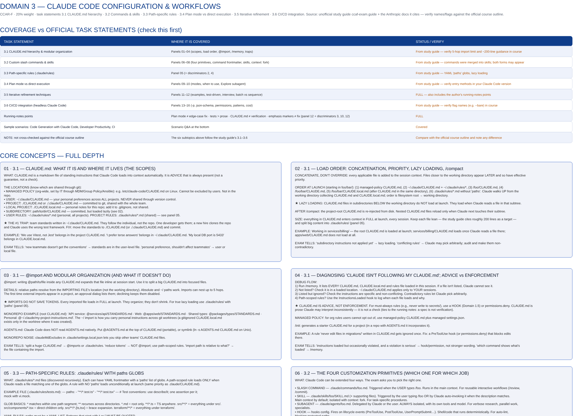

# CCAR-F Study Maps

**Free, visual study maps (Excalidraw) for the Claude Certified Architect – Foundations exam, one big board per domain.**

Each board is built to be scanned on a large monitor: coverage table, deep teaching panels, "if you see X, choose Y" rules, decision matrix, trap answers, words to look for, glossary, flashcards and scenario Q&A. Everything is a real, editable Excalidraw element, so you can move boxes, recolour, and add your own notes.

> **Unofficial.** This project is not affiliated with, endorsed by, or sponsored by Anthropic. It contains no leaked or real exam questions. It is a study aid, and it can contain mistakes. Always verify names, flags, limits and numbers against the official course material and docs. See [DISCLAIMER](#disclaimer).

Top of the Domain 3 board (rough preview image; open the real file for the full ~11,000 px canvas).

## The five domains

| # | Domain | Weight | Sub-topics | Open in browser | Download |
|---|--------|:------:|------------|:---------------:|:--------:|
| 1 | Agentic Architecture & Orchestration (**Part B**, see note) | 27% | 1.1 Agentic loops · 1.2 Coordinator–subagent · 1.3 Invocation & context · 1.4 Enforcement & handoff · 1.5 SDK hooks · 1.6 Task decomposition · 1.7 Sessions & forking | [Open](https://excalidraw.com/#url=https%3A%2F%2Fraw.githubusercontent.com%2Fbharathk5678%2Fccar-f-study-maps%2Fmain%2Fmaps%2Fdomain1_orchestration.excalidraw) | [file](maps/domain1_orchestration.excalidraw) |
| 2 | Tool Design & MCP Integration | 18% | 2.1–2.5 | [Open](https://excalidraw.com/#url=https%3A%2F%2Fraw.githubusercontent.com%2Fbharathk5678%2Fccar-f-study-maps%2Fmain%2Fmaps%2Fdomain2_tool_design_mcp.excalidraw) | [file](maps/domain2_tool_design_mcp.excalidraw) |
| 3 | Claude Code Configuration & Workflows | 20% | 3.1 CLAUDE.md hierarchy · 3.2 Commands & skills · 3.3 Path-specific rules · 3.4 Plan mode vs direct execution · 3.5 Iterative refinement · 3.6 CI/CD | [Open](https://excalidraw.com/#url=https%3A%2F%2Fraw.githubusercontent.com%2Fbharathk5678%2Fccar-f-study-maps%2Fmain%2Fmaps%2Fdomain3_claude_code_workflows.excalidraw) | [file](maps/domain3_claude_code_workflows.excalidraw) |
| 4 | Prompt Engineering & Structured Output | 20% | 4.1 Explicit criteria · 4.2 Few-shot · 4.3 Structured output · 4.4 Validation & retry · 4.5 Batch processing · 4.6 Multi-pass review | [Open](https://excalidraw.com/#url=https%3A%2F%2Fraw.githubusercontent.com%2Fbharathk5678%2Fccar-f-study-maps%2Fmain%2Fmaps%2Fdomain4_prompt_structured_output.excalidraw) | [file](maps/domain4_prompt_structured_output.excalidraw) |
| 5 | Context Management & Reliability | 15% | 5.1 Conversation context · 5.2 Escalation · 5.3 Error propagation · 5.4 Codebase exploration · 5.5 Human review · 5.6 Provenance | [Open](https://excalidraw.com/#url=https%3A%2F%2Fraw.githubusercontent.com%2Fbharathk5678%2Fccar-f-study-maps%2Fmain%2Fmaps%2Fdomain5_context_reliability.excalidraw) | [file](maps/domain5_context_reliability.excalidraw) |

**Note on Domain 1:** the file here is the *Part B* board (the gaps and deeper material for 1.1–1.7). A Part A board covering the basics (single vs multi-agent, orchestration patterns, parallel vs sequential, tool-use loop) is not included yet.

Weights follow the unofficial study guide and may differ from the current official exam guide. Check each board's **Coverage** table first, because it lists what is covered and what still needs verifying.

## How to use these files

1. Click **Open** in the table. The board loads in [excalidraw.com](https://excalidraw.com) directly from this repo (nothing is uploaded anywhere).
2. Or download the `.excalidraw` file and open it with excalidraw.com → **Menu → Open**, drag it onto the canvas, or use the VS Code "Excalidraw" extension or Obsidian's Excalidraw plugin.
3. Start with the **Coverage** table at the top of each board, then read the panels, then do the traps, flashcards and scenario Q&A.

More detail: [docs/HOW_TO_USE.md](docs/HOW_TO_USE.md) · Suggested schedule: [docs/STUDY_PLAN.md](docs/STUDY_PLAN.md) · Make boards for your own course or skill: [docs/MAKE_YOUR_OWN.md](docs/MAKE_YOUR_OWN.md)

## What is inside each board

- **Coverage table**: each task statement, where it is covered, and what to verify
- **Teaching panels**: idea, how it works, exact names and numbers, worked example, look-alike comparisons, exam tells
- **Discriminators**: "if the question says X → pick Y, because Z"
- **Decision matrix**: scenario vs approach
- **Traps**: wrong answers that look right, and why they fail
- **Glossary**: plain-English definitions
- **Flashcards** and **scenario Q&A** for rapid recall

## Sources

- The unofficial study guide at ccaf-exam.guide (task statements, flags, limits) and the Anthropic documentation it cites.
- Original explanations, examples, traps and flashcards written for these boards.

Credit goes to the authors of those sources. If you are a rights holder and want something changed or removed, please open an issue.

## Disclaimer

- Not affiliated with, endorsed by, or sponsored by Anthropic. "Claude" and "Anthropic" are trademarks of their respective owner and are used here only to describe the exam these notes are for.
- Study aid only. It can contain errors or be out of date. Verify against official materials before relying on it.
- No real exam content. Please do not submit leaked or real exam questions to this repo. Scenario Q&As are practice items and follow the style of the sample questions in the public study guide.
- Using these notes does not guarantee a pass.

## Contributing

Corrections and additions are welcome. See [CONTRIBUTING.md](CONTRIBUTING.md).

## License

[MIT](LICENSE) for the original material in this repo. Third-party sources keep their own rights.
